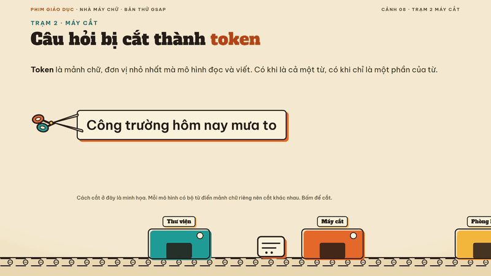
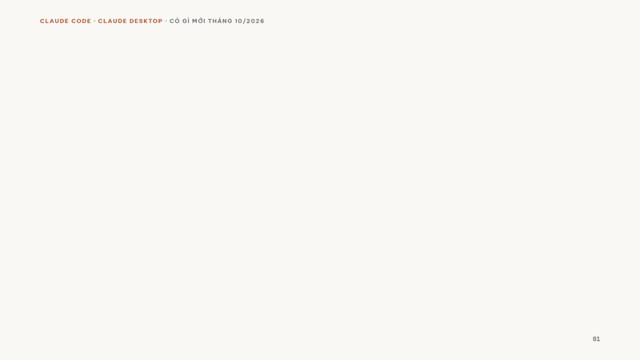
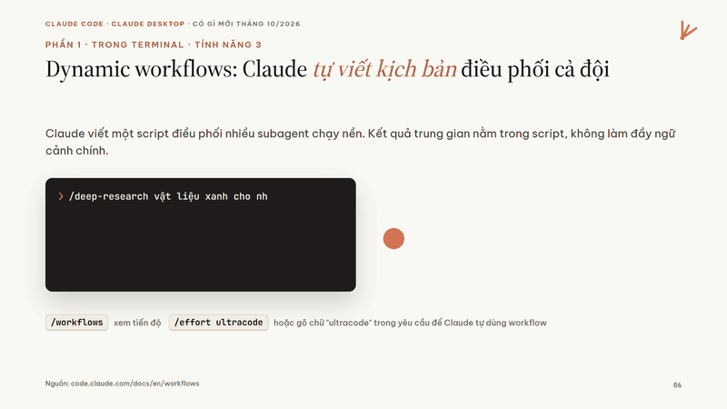

# SlideMotion

**Gõ chủ đề, AI làm đạo diễn, ra deck có hồn.** Không khung dựng sẵn, không slide nào giống slide nào.



SlideMotion là một skill cho Claude Code (và các agent đọc được `SKILL.md`). Thay vì ép AI điền nội dung vào khuôn, nó đưa cho AI ba thứ: một **cuốn sách phong cách 86 style**, một **từ điển chuyển động**, và một **runtime GSAP** nhỏ để chiếu. AI tự nghĩ câu chuyện, tự vẽ hình ẩn dụ bằng SVG, tự dàn dựng từng chuyển động theo động từ của câu.

**Trang giới thiệu, deck mẫu và thư viện style:** https://andyluu98.github.io/slidemotion/

## Vì sao không dùng khung

| Khung dựng sẵn | SlideMotion |
|---|---|
| Kiểu slide định sẵn: tiêu đề trái, gạch đầu dòng, ô nhấn phải | Mỗi slide tự chọn dáng theo ý |
| Hiệu ứng để trang trí, mọi thứ cùng trượt lên | Chuyển động theo động từ: "cắt" thì cắt, "gom" thì gom, "duyệt" thì đóng dấu |
| Đổi chủ đề mà nhìn vẫn như nhau | Mỗi deck một ý tưởng lớn: một thế giới, một nhân vật đi suốt bài |

## Deck mẫu

| | |
|---|---|
|  |  |
| [Có gì mới trong Claude Code](https://andyluu98.github.io/slidemotion/demos/claude-co-gi-moi.html): 19 slide, style Claude Ivory, ngôi sao mọc thêm một cánh sau mỗi tính năng | Bấm một lần: lệnh được gõ ra, việc tỏa ra nhiều agent rồi gom về một báo cáo |

Thêm: [Nhà máy chữ](https://andyluu98.github.io/slidemotion/demos/nha-may-chu-gsap.html) (bên trong một chatbot, phim giáo dục thập niên 50) và [Một ngày ở công trường](https://andyluu98.github.io/slidemotion/demos/mot-ngay-o-cong-truong.html) (AI trong xây dựng, máy quay lia theo công trường).

Mỗi deck là **một file HTML**, chiếu offline được: mũi tên hoặc Space để chuyển, F toàn màn hình, Ctrl+P ra bản phát tay (mọi slide trải ra, mọi bước đã hiện).

## Cài vào Claude Code

```bash
git clone https://github.com/andyluu98/slidemotion ~/.claude/skills/slidemotion
```

Rồi nói với Claude: `làm slide 15 trang về an toàn lao động, style blueprint`. Claude tự nạp skill, chọn chế độ, gợi ý style và dựng.

## Có gì trong repo

| Thư mục | Nội dung |
|---|---|
| `SKILL.md` | Tinh thần, quy trình 6 bước: chọn chế độ, ý tưởng lớn, chọn style, kịch bản đạo diễn, dựng bằng GSAP, tự soát |
| `modes/` | Ba chế độ: `giang-day` (dạy lý thuyết), `bao-cao` (trình bày kết quả, số liệu có nguồn), `su-kien` (ra mắt, pitch) |
| `styles/` | `INDEX.md` để chọn style, 86 thẻ gợi ý (màu, chữ, ngôn ngữ minh họa, chữ ký chuyển động, khoảnh khắc đáng nhớ) |
| `motion/tu-dien.md` | Động từ của ý, hiệu ứng HTML tương ứng, hiệu ứng PowerPoint tương ứng |
| `scenes/cong-thuc.md` | 13 công thức cơ chế (bấm từng bước, câu hỏi kiểm tra, toàn cảnh lia, vật xuyên suốt...), cố ý không có bố cục để AI không chép |
| `runtime/deck.js` | Co khung 16:9, điều hướng, `data-anim`, `data-step`, `data-morph`, `data-count`, toàn cảnh lia, in bản phát tay |
| `runtime/gsap-scenes.js` | Mỗi slide một dòng thời gian GSAP: phần đầu là cảnh vào, mỗi nhãn `step1`, `step2` là một cú bấm, bấm lùi thì tua ngược |
| `runtime/cinema.js` | Lớp hiệu ứng nhẹ không cần thư viện (chuyển cảnh, chữ tách ký tự, lò xo) |
| `runtime/vendor/gsap-3.15.0/` | GSAP và các plugin SplitText, DrawSVG, MorphSVG, MotionPath, Flip, CustomEase, CustomBounce, ScrambleText, nhúng sẵn để chiếu offline |
| `examples/` | Cùng chủ đề AI trong xây dựng, dựng theo ba cách khác hẳn nhau |
| `tests/` | Tệp kiểm thử runtime, không dùng làm mẫu thiết kế |
| `tools/build-gallery.py` | Gom 86 thẻ style thành dữ liệu cho trang giới thiệu |
| `docs/` | Trang giới thiệu trên GitHub Pages |

## Một cảnh viết thế nào

```html
<section class="slide s8" data-steps="1"> ... HTML là trạng thái cuối ... </section>
<script>
scene('.s8', (s, tl, k) => {
  tl.from(SplitText.create(s.querySelector('h2'), { type: 'words' }).words, { y: 40, opacity: 0, stagger: .05 });
  tl.addLabel('step1')                       // cú bấm thứ nhất chạy từ đây
    .to('.scissors', { x: 900, duration: 1.4, ease: 'none' }, 'step1');
});
</script>
```

## Trạng thái

- [x] Runtime, SKILL.md, từ điển chuyển động
- [x] Đủ 86 thẻ style
- [x] Ba chế độ: giảng dạy, báo cáo, sự kiện; công thức cơ chế; in bản phát tay
- [x] Chuyển động bằng GSAP theo dòng thời gian
- [ ] Xuất PowerPoint giữ hiệu ứng tương ứng

## Giấy phép và ghi công

- Mã và thẻ style của SlideMotion: MIT (xem `LICENSE`).
- GSAP trong `runtime/vendor/` theo giấy phép riêng của GSAP (https://gsap.com/standard-license), không phải MIT; giữ nguyên phần ghi bản quyền trong file. Xem `NOTICE.md`.
- Nhiều style phỏng theo MotionFly / lemo-opuscar (MIT) và frontend-slides (MIT); ghi công cụ thể ở cuối từng thẻ.
- Style Claude Ivory và deck mẫu về Claude Code phỏng theo nhận diện công khai của Claude để minh họa; SlideMotion không liên kết với Anthropic.
